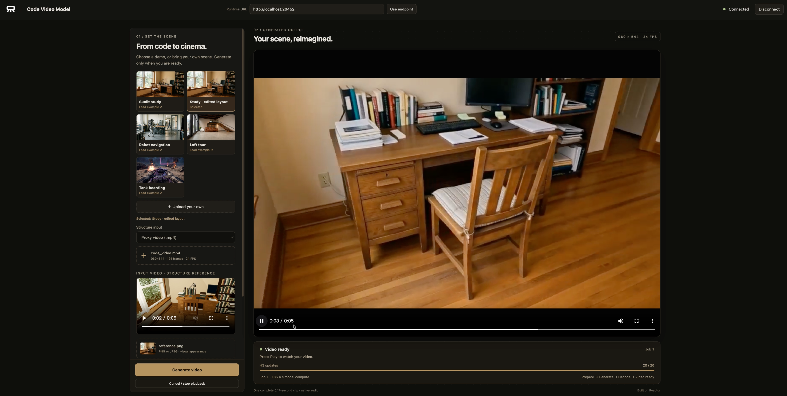

# Code Video Model on Reactor

Generate code-conditioned videos with [Code Video Model](https://github.com/code-video-model/CodeVideoModel),
powered by [Reactor](https://reactor.inc). Upload a procedural Three.js scene or its rendered
proxy video, choose a style reference, describe the scene, and generate a complete video with audio.



Shown with the authors' [edited chair-placement example](https://github.com/code-video-model/CodeVideoModel/tree/main/examples/chair_placement/edited), selected and generated through the demo.

What this integration adds:

- A Reactor service and a small browser client, launched from a YAML build definition.
- CPU rendering of uploaded scene code in a separate, resource-limited container.
- Explicit input selection, generation progress, and cancellation between generation updates.
- Complete 124-frame videos at 960×544, played at 24 FPS with synchronized audio.

Each generation is an independent clip. The prompt stays fixed until it finishes;
enter a new prompt and click **Generate video** for another clip. No image is selected automatically.

## What you need

- Linux, two NVIDIA B200 GPUs, Docker and the NVIDIA Container Toolkit.
- The [Reactor CLI](https://docs.reactor.inc/deploy/platform/installation).
- Approximately 210 GB for the native checkpoint, plus the image and download cache.
- Node.js 22+ and npm for the browser client.

Use this directory as your working directory for the commands below.

## 1. Build the service

```sh
reactor validate
reactor build
```

`reactor.yaml` defines the image with Reactor Runtime 3.8.1 and CUDA 12.8.
Rebuild after changing Python files, dependencies or the build configuration.

## 2. Start the model

Choose two available GPUs. The first runs video generation; the second runs the text encoder.

```sh
reactor run --gpus '"device=0,1"' --shm-size 2g --port 8080
```

First startup downloads the pinned upstream source and checkpoint into `runtime.weights_path`.
Use a current Reactor CLI with `--shm-size` support. Returning a complete clip through
the worker's shared memory requires more than Docker's 64 MiB default.
Later starts reuse them. Set `--weights /path/to/persistent/cache` to choose a different storage
location. The download follows the author's checkpoint manifest and retains its full sampling schedule.

**Check:** `curl -s http://localhost:8080/health` reports `"state":"available"`.
Keep this terminal open; `Ctrl+C` stops the service. A generation failure in the GPU worker
requires restarting the service; reconnecting the browser alone does not restart a failed worker.

## 3. Open the client

In another terminal:

```sh
cd demo
npm ci
npm run dev -- --host 127.0.0.1
```

Open the URL printed by Vite. In the top bar, set **Runtime URL** to `http://localhost:8080`, click
**Use endpoint**, then **Connect**. Choose a proxy MP4 and a reference image, enter the scene
prompt, and click **Generate video**. Selecting files alone does not start generation.

The author's `examples/robot_navigation/` contains a matching `code_video.mp4`, `reference.png`
and `prompt.txt` for an initial test. Select these files yourself; the service has no default scene.

Alternatively, choose an example card in the left sidebar: Sunlit study, Study · edited layout,
Robot navigation, Loft tour, or Tank boarding. Each explicitly selected demo downloads the
authors' matching proxy video, reference image and prompt from the pinned source revision.
Review the reference preview, edit the prompt if desired, then click **Generate video**.
Selecting a card never sends inputs to the model or starts generation. These examples use
pre-rendered proxy videos, so they do not require the optional scene renderer.

Click **Upload your own** to clear the example and select your own scene ZIP, PNG/JPEG
reference and prompt. Start the renderer below when using ZIP inputs; choose **Proxy video**
instead if you already have a rendered MP4. You may also replace the reference or edit the
prompt of a selected demo. All three inputs are required. Example downloads need browser
access to GitHub; custom uploads do not depend on that download service. Example assets are
by the CodeVideoBench contributors under CC BY 4.0, linked in the gallery.

The video stage and phase panel stay visible while the desktop input sidebar scrolls
independently. The panel distinguishes model loading, example downloads, uploads, CPU
scene rendering, input preparation, generation, decoding and video readiness. Its 0–20
progress bar counts completed model updates, not estimated total-job progress. Phase
elapsed time is a browser waiting timer; model compute time comes from Runtime. On
smaller screens the video and phase panel appear above the input controls.

The selected proxy MP4 has a local preview in the sidebar. Runtime saves each completed
video as an MP4 through `runtime.step_results`, enabled in `reactor.yaml`. The client
downloads the current job's complete video and audio over HTTP. Press Play when
**Video ready** appears; pause, seek, replay and natural end use the downloaded file.
**Cancel / stop playback** cancels generation or pauses and rewinds a ready video.
Keep the page open to retain the downloaded clip; Runtime keeps result files for five
minutes. The MP4 uses H.264/AAC encoding at the model's native 24 FPS.

The proxy must be H.264/yuv420p, 960×544, exactly 124 frames at 24 FPS, with no audio.
References may be PNG or JPEG, up to 20 MiB / 16 megapixels, with aspect ratio between 1:4
and 4:1. Reference resizing follows the original implementation.

### Access over SSH

Forward the frontend and Runtime HTTP ports. WebRTC media also needs a reachable transport:
SSH `-L` forwards TCP, so configure an authenticated TURN-over-TCP relay and forward its listener
as well. Docker host networking alone does not forward WebRTC UDP through SSH.
Use the [Runtime networking documentation](https://docs.reactor.inc/deploy/development/local-testing)
and validate video and audio from the actual browser connection. Keep relay credentials outside this repository.

## 4. Render a Three.js scene

The renderer is optional when uploading an existing proxy video. Uploaded JavaScript runs in
a dedicated container with no network, GPU, credentials or Docker socket. The service communicates
through a Unix socket mounted under the persistent weights directory.

After the first model startup has downloaded the source, start the renderer using the **same**
weights directory used by `reactor run`. For a Cookbook workspace the image is
`reactor-local/code-video-model:dev`; building from upstream's `reactor/` names it
`reactor-local/reactor:dev`.

```sh
CVM_WEIGHTS=/absolute/path/to/the/model/cache
CVM_IMAGE=reactor-local/reactor:dev
mkdir -p "$CVM_WEIGHTS/render"
chmod 700 "$CVM_WEIGHTS/render"
docker run --rm --name cvm-renderer \
  --network none --user "$(id -u):$(id -g)" --read-only \
  --cap-drop ALL --security-opt no-new-privileges \
  --pids-limit 256 --memory 4g --cpus 8 --cpuset-cpus 0-7 \
  --tmpfs /tmp:rw,nosuid,nodev,size=1g,mode=1777 \
  -e HOME=/tmp -e NVIDIA_VISIBLE_DEVICES=void \
  -e PYTHONPATH=/opt/venv/lib/python3.12/site-packages \
  -v "$CVM_WEIGHTS/render:/render" \
  -v "$CVM_WEIGHTS/CodeVideoModel:/source:ro" \
  --entrypoint /opt/renderer-python/bin/python3.12 "$CVM_IMAGE" \
  /app/code_video_model_render.py --socket /render/renderer.sock --source /source
```

**Check:** the weights directory contains `render/renderer.sock`.
Choose eight available host CPU cores and adjust `--cpuset-cpus` accordingly. CPU
affinity bounds SwiftShader's worker pool on large servers; the quota alone may
leave hundreds of contending rendering threads.
The renderer refuses running directly on the host or as root. Stop it before removing a stale
socket after an unclean shutdown. Do not mount your home directory, API credentials or GPU weights into it.

In the demo, select **Three.js scene (.zip)**. Package only the scene's `case/` directory:
`case/index.html` and its local HTML, JavaScript, CSS, JSON or shader modules. The server supplies
the author's vendored Three.js and fixed render settings. Archives are limited to 128 entries and
8 MiB expanded size; links and path traversal are rejected. Scenes must implement the original
`window.reconstruction` contract, including deterministic `seek`, `pause` and `getCameraState`.

The service renders every frame at its exact timestamp using the author's Chromium/SwiftShader
renderer, then passes the resulting video to H3. Rendering has a 300-second deadline. Select
your reference and prompt as usual; **Generate video** performs rendering before GPU generation.

### Creating new scene code and reference images

Use the original repository's `inference.generate_threejs` and reference-generation tools to
author scenes and reference images. They require the author's Copilot/GPT and OpenRouter setup.
This service accepts their outputs. It does not expose an unrestricted coding agent or place
its API credentials inside the renderer. Pure-text scene authoring and automatic reference-image
generation have not been integrated into this demo.

## Controls

| Command | Effect |
| --- | --- |
| `set_proxy` | Validate and select a proxy video; wait for `start`. |
| `set_scene` | Render an uploaded scene ZIP in the isolated renderer and select its proxy; wait for `start`. |
| `set_reference` | Select a reference image; wait for `start`. |
| `start` | Snapshot the prompt, seed and selected inputs for a new clip. Refuse if inputs are missing or a job is active. |
| `cancel` | End the active job at the next generation boundary and flush buffered playback. |

`state_update` reports selected inputs, job ID, phase, completed generation updates and measured
compute time. It is broadcast after state changes and sent to joining viewers. Generation always
uses twenty updates; **Proxy-conditioned updates** selects how many initial updates use the
proxy (default five). Cancellation waits for the current update, preparation or decoding to finish.

## More

Tested on two B200 GPUs with the native twenty-update schedule. Two consecutive
robot-navigation jobs in the final browser playback test took 186.9 and 187.2 seconds
of model compute each for 124 frames (about 0.66 generated FPS); playback is 24 FPS.
Both complete MP4 downloads passed pause, stop, seek and natural-end checks, with
the SDK connection using TURN/TCP. Scene-ZIP rendering, cancellation and reconnects
were also tested during integration. CPU rendering and file-transfer time are separate
from the model-compute figures.

A separate native-versus-adapter comparison used the robot-navigation proxy,
reference and prompt, seed 42, five proxy-conditioned updates and twenty updates
in total. Video/audio latents, decoded RGB and floating-point audio hashes matched
exactly before media encoding. This comparison covers that fixed example. Native
32 kHz audio is explicitly resampled to 48 kHz for delivery; the downloadable MP4
uses H.264/AAC encoding. The 22 CPU tests cover application hooks, model lifecycle,
upload validation and audio conversion.

- [Original project and inference instructions](https://github.com/code-video-model/CodeVideoModel).
- [Reactor model authoring](https://docs.reactor.inc/deploy/development/reactor-app/application-and-model).
- `code_video_model.py` owns client commands and the Runtime hooks; `_model.py` owns each finite
  job; `_backend.py` reuses CVM's conditioning, integrator and decoders; `_render.py` isolates code rendering.
- The public schema is available at `/schema`. The included frontend targets local services;
  a hosted frontend also needs a server-side token exchange.

## Credits and licence

Thanks to [Rising0321](https://github.com/Rising0321) for porting Code Video Model to Reactor.
Code Video Model and MiniMax-H3 remain the work of their original authors. Preserve the upstream
Apache-2.0 licence, checkpoint terms, and the separate licences and attribution of example assets.
